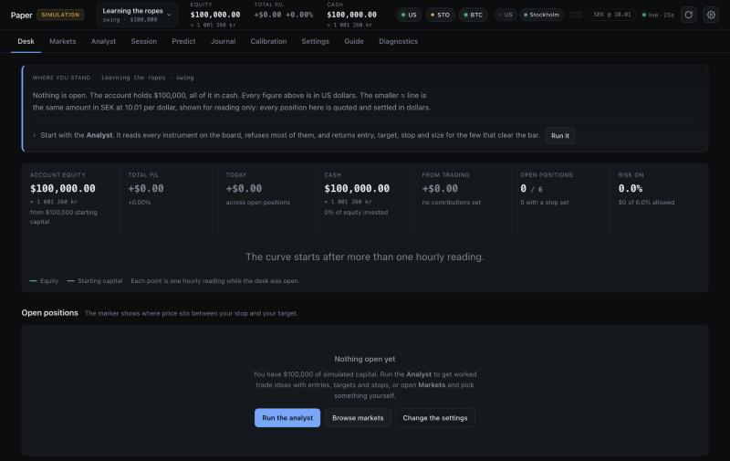
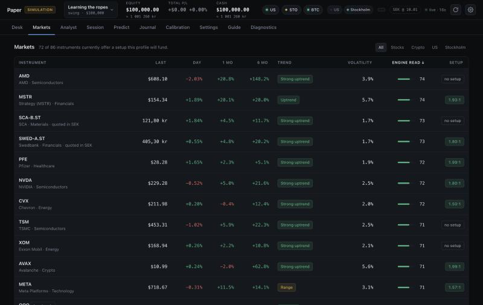
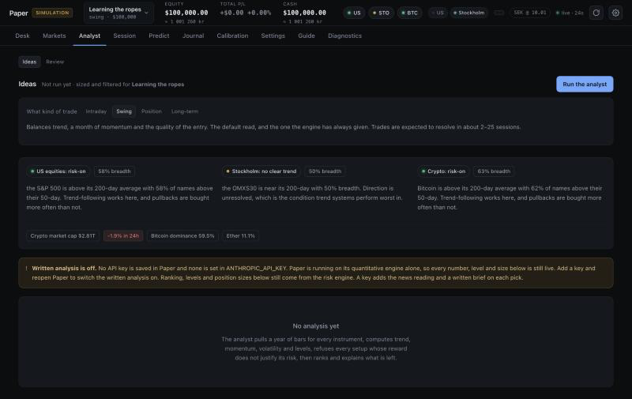

# Paper

Paper is a trading simulator for macOS. It uses real market prices and a pretend account, and it shows its working: for each idea it gives an entry, a stop, a target and a position size, and says why each number sits where it does.

Nothing is ever bought or sold. There is no brokerage connection and no credential anywhere in the app that could reach a market.

<p>
  
  
  
</p>

The screenshots show a fresh account. The Analyst tab is running with no API key, which is how Paper starts.

## What it does

- **A market of 89 instruments.** 48 US equities, the 30 largest companies on Nasdaq Stockholm, 8 crypto pairs and 3 index benchmarks. Quotes refresh about every 15 seconds while the app is open.
- **Asks who is trading before it shows anything.** A profile holds capital, contributions, income, expenses, emergency savings, objective, horizon and universe. Risk capacity is worked out from those circumstances and caps the risk the user says they want. There are five presets, and each profile keeps its own ledger.
- **Ranks, refuses and sizes.** The analyst scores the board for a chosen horizon (intraday, swing, position or long-term), rejects setups whose reward does not justify the risk, and sizes the rest from the profile's limits. The same board produces different shortlists for different horizons.
- **Charges for realism.** Every fill crosses a spread and pays commission. Stops gap through when a session opens past them. Realised gains are taxed by holding period. Exchanges keep their own hours and holiday calendars, and US equities obey the pattern day trader rule.
- **Reviews closed trades.** A post-mortem on each trade, including what the instrument did after the exit, and a report on how the account is being run.
- **Grades its own picks.** The Calibration tab scores every recommendation against what price did next, including the ones that were never taken, and proposes named, evidenced changes to how the next analysis behaves. Nothing changes until the user accepts a proposal.
- **Timed sessions.** A day-trading run on five-minute bars with a fixed stake and duration, and rules that cannot be edited while the clock runs.
- **A prediction desk.** It watches Polymarket's rolling five-minute Bitcoin market and places simulated bets from its own invented bankroll, using public data. It has no wallet and no key.
- **Two currencies.** Prices keep their native currency, so Stockholm names are quoted in kronor. Account money is always in US dollars, converted when a position is opened and when it is marked.

## The analyst and API keys

Paper works without any key. The ranking, levels, position sizes and refusals all come from the local risk engine.

An optional Anthropic API key adds the written analysis: a news reading, a cross-instrument view and a brief on each pick. A key is entered in the app, verified with a single one-token request, and stored in the macOS Keychain. It is never written to a file, a log or an export, and no key is included in this repository. The `ANTHROPIC_API_KEY` environment variable is also honoured. Each run has a token budget and a wall-clock ceiling.

When a key is set, the analyst sends the active profile's circumstances to Anthropic along with instrument metrics, headlines and trade records. [SECURITY.md](SECURITY.md) lists exactly what.

## Requirements

- An Apple silicon Mac on macOS 14 or later
- Xcode Command Line Tools (Swift 5.9 or later)
- An internet connection for prices

## Build and run

```bash
git clone https://github.com/adam-dev-haven/paper.git
cd paper
./build.sh
open Paper.app
```

`build.sh` runs the self-test first and refuses to produce a bundle if it fails. It then writes an ad-hoc signed `Paper.app` into the project folder. The bundle identifier defaults to `com.example.paper`. Set your own with `PAPER_BUNDLE_ID=com.yourname.paper ./build.sh`.

On first launch Paper writes five preset profiles, each with its own simulated starting capital and an empty ledger, and opens a short onboarding. No trades, history or settings are pre-filled. Step-by-step instructions and troubleshooting are in [docs/GETTING-STARTED.md](docs/GETTING-STARTED.md).

## Your data

| What | Where |
|---|---|
| Ledgers, one per profile | `~/Library/Application Support/Paper/ledgers/` |
| Ledger backups | `ledgers/backups/`, one copy per launch, the last 20 kept |
| Logs | `~/Library/Application Support/Paper/logs/`, two weeks kept |

A ledger that cannot be read is never overwritten. Paper copies it aside, puts that account into read-only mode for the session and says so in a banner.

## Tests

```bash
swift build -c release --arch arm64
PAPER_DATA_DIR="$(mktemp -d)" .build/release/Paper --selftest
```

The suite runs inside the app binary. It covers the indicators and the trade planner, the ledger and tax lots, the friction model, exchange calendars, currency conversion, profile suitability, the prediction desk, and the on-disk schema gate. It also starts the local server and sends it hostile requests over a real socket. It prints the number of passing assertions and exits non-zero on any failure.

`PAPER_DATA_DIR` points a run at a scratch folder. Use it for every test run so your own accounts are never opened.

## Project layout

```
Sources/Paper/   The engine, the ledger, the local server and the app shell (Swift)
site/            The interface: plain ES modules, no build step, no dependencies
docs/            Getting started, architecture, data sources
build.sh         Test, build, bundle and sign
```

The app is a native window around a web view. It starts a small HTTP server on a loopback port, and the interface in `site/` talks to it with `fetch`. [docs/ARCHITECTURE.md](docs/ARCHITECTURE.md) explains the pieces and why they are shaped this way.

## Not investment advice

Paper is an educational tool. It does not recommend buying or selling any real security, and nobody involved knows your finances or your tolerance for loss. A simulator flatters the user in ways it cannot fully correct: being wrong costs nothing emotionally, and the instrument list is a curated set of survivors.

## Licence

Released under the [MIT licence](LICENSE). Where the prices come from, and the terms attached to them, is described in [docs/DATA-SOURCES.md](docs/DATA-SOURCES.md).
